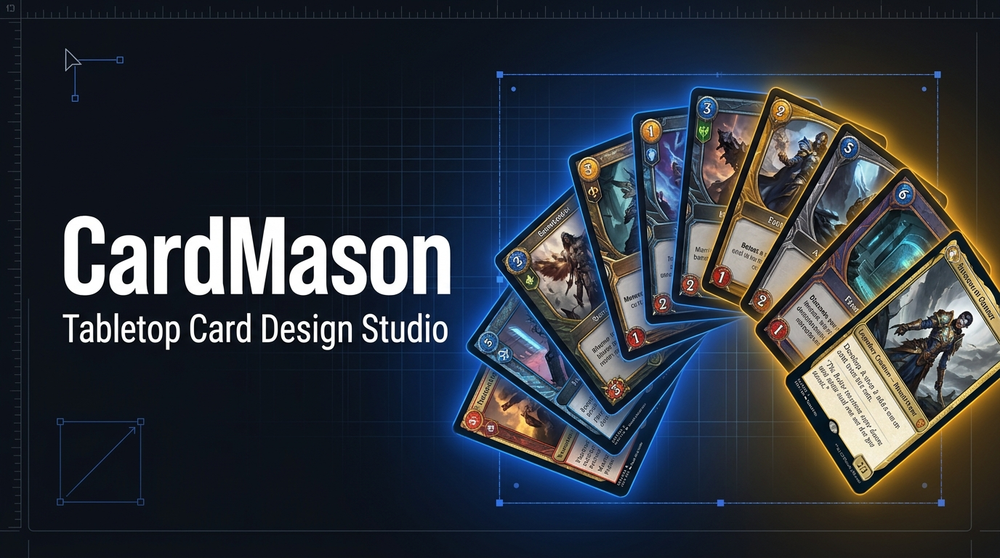

# 🎴 CardMason (Beta) — Public Releases

  <a href="#-español"><b>🇪🇸 Español</b></a> &nbsp;•&nbsp; <a href="#-english"><b>🇬🇧 English</b></a>

---

## 🇪🇸 Español

> **CardMason** es un editor local y ágil para el diseño, maquetación y producción de cartas y componentes de juegos de mesa basado en plantillas visuales, datos tabulares y renderizado vectorial SVG. **100% privado, local y sin servidores (*local-first*)**.

Creado por **ZVirus & Qualith**.

---

### 🚀 Descarga Rápida (Windows x64 Portable)

No requiere instalación, ni Node.js, ni registros. Solo descargar el ejecutable y abrirlo directamente con doble clic:

> 💡 **Enlace permanente a la última versión disponible:**  
> 👉 **[Descargar la última versión desde GitHub Releases](https://github.com/ZVirusIDH/CardMason-Releases/releases/latest)**

#### 📖 Cómo empezar en 3 pasos:

1. **Descarga** el archivo `CardMason-0.2.0-Windows-x64-Portable.exe` desde la sección de **[Releases](https://github.com/ZVirusIDH/CardMason-Releases/releases)**.
2. **Haz doble clic** sobre el archivo descargado para iniciar CardMason.  
   *(Al tratarse de software independiente en fase Beta sin certificado corporativo de pago de Microsoft, si Windows SmartScreen muestra la ventana azul «Windows protegió su PC», pulsa en **"Más información"** y luego en **"Ejecutar de todas formas"**)*.
3. Elige o crea una carpeta en tu ordenador para guardar tu proyecto y ¡empieza a diseñar!

---

### ✨ Características Principales

- **100% Local-first y Privado**: Todo el procesamiento se realiza en tu equipo. Tus proyectos, cartas e imágenes nunca se envían a servidores externos ni a la nube.
- **Sin Instalación**: Ejecutable autónomo portable de doble clic.
- **Tira de cartas y vista previa en directo**: Navegación rápida por índice numérico (`# [ N ] / Total`) y miniaturas de cartas renderizadas en tiempo real.
- **Tabla de datos estilo hoja de cálculo**: Celdas editables con menú contextual (cortar, copiar, pegar, insertar filas y ordenar; compatible con Excel y Google Sheets).
- **Gestión visual de recursos**:
  - Importación de fuentes tipográficas personalizadas (TTF/OTF) por arrastrar y soltar (*drag & drop*).
  - Catálogo de iconos vectoriales con macros en línea automáticas (ej. `[fuego]`, `[oro]`).
  - Herramienta interactiva de recorte OCR para digitalizar cartas físicas escaneadas.
- **Formatos canónicos internacionales**: Presets de medidas estándar de la industria (A hasta P) y exportación a PDF a escala 1:1 real para imprenta.
- **Formatos abiertos**: Proyectos empaquetados en contenedor único `.cardmason` y exportaciones vectoriales SVG limpias.

---

### 💬 Soporte, Sugerencias y Reporte de Errores

Si encuentras algún fallo, tienes sugerencias para mejorar el programa o quieres compartir tus proyectos con CardMason:
- Abre una incidencia en la pestaña **[Issues](https://github.com/ZVirusIDH/CardMason-Releases/issues)** de este repositorio.

---
---

## 🇬🇧 English

> **CardMason** is a lightweight, local-first tool for fast design, layout, and production of tabletop game cards and components, powered by visual templates, tabular data, and SVG vector rendering. **100% private, offline, and serverless**.

Created by **ZVirus & Qualith**.

---

### 🚀 Fast Download (Windows x64 Portable)

No installation required, no Node.js, and no account signup. Simply download the standalone executable and launch it with a double-click:

> 💡 **Permanent link to the latest available release:**  
> 👉 **[Download the latest version from GitHub Releases](https://github.com/ZVirusIDH/CardMason-Releases/releases/latest)**

#### 📖 Getting started in 3 steps:

1. **Download** the `CardMason-0.2.0-Windows-x64-Portable.exe` file from the **[Releases](https://github.com/ZVirusIDH/CardMason-Releases/releases)** section.
2. **Double-click** the downloaded file to start CardMason immediately.  
   *(As this is independent Beta software without a paid commercial code-signing certificate, if Windows SmartScreen displays the blue «Windows protected your PC» prompt, click **"More info"** and then **"Run anyway"**)*.
3. Choose or create a folder on your computer to save your project and start creating your cards!

---

### ✨ Key Features

- **100% Local-first & Private**: All data handling and rendering occur strictly on your machine. Your cards, decks, and images are never transmitted to cloud servers.
- **No Setup Needed**: Fully portable, self-contained double-click executable.
- **Interactive Filmstrip & Live Previews**: Fast numerical card navigation (`# [ N ] / Total`) and real-time rendered vector thumbnails.
- **Spreadsheet-Style Data Table**: Editable cells with right-click context menus (cut, copy, paste, row insertion, and sorting; compatible with Excel and Google Sheets).
- **Integrated Asset Managers**:
  - Drag-and-drop custom font importer (TTF/OTF).
  - Vector icon catalog with automated inline macros (e.g. `[fire]`, `[coin]`).
  - Interactive OCR crop tool to extract text and icons from scanned physical cards.
- **Canonical International Dimensions**: Standard industry card presets (formats A through P) and 1:1 true-scale PDF print sheet exports.
- **Open Formats**: Self-contained single-file `.cardmason` project archive and clean SVG vector exports.

---

### 💬 Support, Feedback & Bug Reports

If you run into an issue, have ideas for improvements, or want to share your feedback:
- Open a ticket in the **[Issues](https://github.com/ZVirusIDH/CardMason-Releases/issues)** section of this repository.

---

  © 2026 CardMason — Created by <b>ZVirus & Qualith</b>. All rights reserved.

